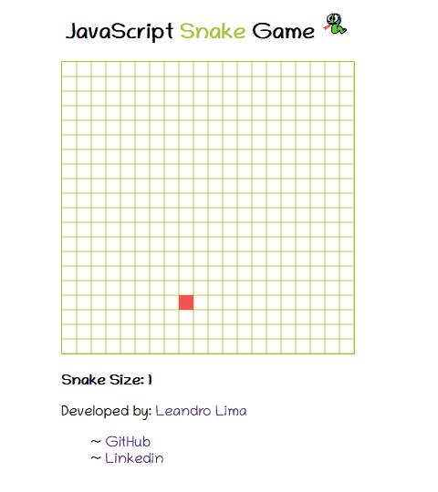

# SnakeGame

Jogo da cobrinha (Snake) feito com JavaScript e HTML Canvas.



## Como jogar

1. Clone ou baixe o repositório.
2. Abra o arquivo `index.html` no navegador. Não é preciso instalar nada nem usar servidor.
3. Use as **setas do teclado** para mover a cobra.

**Regras**
- Comer a comida (quadrado vermelho) faz a cobra crescer e aumenta a pontuação, mostrada em *Snake Size*.
- Ao sair por uma borda, a cobra reaparece na borda oposta.
- Se a cabeça encostar no próprio corpo, o jogo termina (*Game Over*) e reinicia.
- A cobra não pode dar meia-volta de uma vez (por exemplo, ir de "direita" direto para "esquerda").

## Estrutura do projeto

```
SnakeGame/
├── assets/            Imagens e som (beep.mp3)
├── objects/
│   ├── World.js       Tabuleiro: único responsável por desenhar no canvas
│   ├── Snake.js       Cobra: movimento, crescimento, colisão e desenho
│   └── Food.js        Comida: sorteio de posição e desenho
├── test/              Testes
├── config.js          Constantes do jogo (tamanhos, cores, intervalo, direções)
├── game.js            Ponto de entrada: monta o jogo e executa o loop principal
├── index.html         Página do jogo
└── style.css          Estilos
```

### Como as partes se conectam

```
game.js ──cria──▶ World ◀──usa── Snake
   │                ▲
   └────cria──▶ Food┘        config.js é lido por todos
```

- `game.js` cria `World`, `Snake` e `Food` e, a cada 120 ms, redesenha o tabuleiro, move a cobra e verifica se ela comeu.
- `Snake` e `Food` não mexem direto no canvas: pedem ao `World` para pintar (`fillBox`).
- **A ordem dos scripts no `index.html` importa**: `config.js` deve vir primeiro, pois os demais dependem dele.

## Configuração

Tudo o que pode ser ajustado fica em `config.js`:

| Opção | O que controla | Valor atual |
|---|---|---|
| `canvasWidth` / `canvasHeight` | Tamanho da área do jogo (px) | 400 |
| `cellSize` | Tamanho de cada quadradinho (px) | 20 |
| `tickIntervalMs` | Velocidade do jogo (menor = mais rápido) | 100 |
| `colors` | Cores da grade, da cobra e da comida | verde / vermelho |
| `beepSoundPath` | Som ao comer | `./assets/beep.mp3` |

> Se mudar o tamanho do canvas, ajuste também o `width`/`height` do `canvas` e o `width` de `.game-container` no `style.css`.

## Padrões de código adotados

Este projeto passou por uma refatoração baseada em princípios de código limpo e manutenibilidade, **sem alterar o comportamento do jogo**:

- **Sem duplicação (DRY):** grade, sorteio de posição, controle de direção, movimento e desenho de células foram unificados em funções reutilizáveis.
- **Sem valores soltos:** números, cores e nomes de teclas ficam no `config.js`.
- **Responsabilidade única:** somente o `World` desenha no canvas; o fim de jogo e o desenho de cada quadro têm funções próprias.
- **Baixo acoplamento:** `Snake` e `Food` recebem o `World` no construtor, em vez de ele ser atribuído depois.
- **Funções pequenas e nomes claros:** cada função faz uma única coisa.
- **Documentação:** todas as classes e métodos têm comentários JSDoc que explicam o propósito e o porquê das decisões.
- **Código morto removido:** chamadas que não tinham efeito (`fill()` nas linhas da grade e `save()` a cada quadro).
- **HTML melhorado:** scripts no lugar correto, `alt` na imagem, `rel="noopener noreferrer"` nos links externos e sem estilos inline.
- **Um só código-fonte:** o projeto usa apenas JavaScript, sem arquivos duplicados em TypeScript.

## Pontos de melhoria futuros

Itens identificados, mas mantidos para não alterar o comportamento original:

- `Food.isColliding` verifica a colisão e também sorteia nova posição; as duas ações poderiam ser separadas.
- A comida pode surgir sobre o corpo da cobra.
- Alguns nomes (`dontColideWithEndOfCanvas`, `getSnakeTrail`) poderiam ser mais claros e ter a grafia corrigida.
- Adicionar testes automatizados para `Snake`, `Food` e `World`.

## Créditos

Projeto original por [Leandro L.](https://leandrols.github.io) — [repositório original](https://github.com/LeandroLS/SnakeGame). Versão refatorada para a disciplina de Construção de Software de Sistemas Para Internet.
